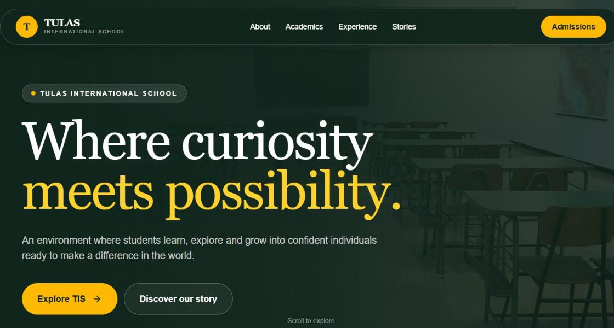

# School Homepage Redesign (Next.js)

A responsive homepage redesign **concept** for Tulas International School, built to practise modern frontend development. It is an unofficial practice project, not the school's website, and is not affiliated with the school. Testimonials and figures on the page are placeholders.

**Live demo:** https://tis-homepage-redesign-two-beta.vercel.app/



## What it shows

- A single-page layout built from reusable React components (`Reveal`, `SectionLabel`)
- Content kept in data arrays (`navItems`, `stats`, `programs`, `testimonials`) and rendered with `.map()`, so text can change without touching layout code
- Mobile navigation menu using React `useState`
- Scroll-reveal animations and a scroll progress bar with Framer Motion (`whileInView`, `useScroll`, `useSpring`)
- Responsive design for mobile, tablet and desktop using Tailwind CSS breakpoints (`sm:`, `md:`)
- Deployed on Vercel

## Tech stack

Next.js (App Router) · React · TypeScript · Tailwind CSS · Framer Motion · Lucide icons · Vercel

## Run locally

Requires Node.js 18+.

```bash
git clone https://github.com/rajkumarprog/tis-homepage-redesign.git
cd tis-homepage-redesign
npm install
npm run dev        # http://localhost:3000
```

Other scripts:

```bash
npm run build      # production build
npm run lint       # ESLint
```

## Project structure

```
app/
  layout.tsx    # root layout, fonts and page metadata
  page.tsx      # the homepage: data arrays, Reveal/SectionLabel components, all sections
  globals.css   # Tailwind import and base styles
public/         # static assets
```

## Possible next steps

- Split `page.tsx` into one component file per section
- Replace placeholder content with real, approved content
- Add an accessible focus style and `aria-expanded` to the mobile menu button

## Author

**Rajkumar Panikera** · [LinkedIn](https://www.linkedin.com/in/rajkumar-panikera-a083ab1a5) · [GitHub](https://github.com/rajkumarprog)
